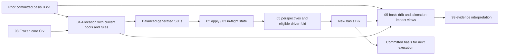

# Stream evolution, allocation feedback and AIM iteration

**Owner update, 2026-11-17:** The ongoing attempt is now designated a formally
measured observational baseline for the
[CKB transfer study](REPORTING_CKB_TRANSFER_STUDY.md), with a matched improved
rerun protocol. This supersedes the earlier nonmeasurement intent below without
backdating registration or promoting it to a replicated paper cost point. Keep
the running architecture unchanged; preserve existing and terminal evidence.

2026-11-17. Status: **design_only**. Owner-directed assessment for the next
phases. Keep the current generation/reporting execution in its existing
configuration. This plan implements no engine, changes no live class, runs no
Q2 model and establishes no cost-curve point.

The objective is a reusable economic processing loop: apply allocation rules
using a prior committed basis, report the resulting state, generate the next
basis from updated eligible data, and quantify what the basis change would do
to the allocations just produced. Rapid rule/model iteration is the capability
being enabled; eliminating file passes is one means of enabling it.

## 1. Preserve the current execution as the Q2 data foundation

The current financial replay passed all fourteen year controls and the shared
population controls: 261,529,946 historical plus 4,789,872 wholly generated SJE
rows, totaling 266,319,818. These are journal rows, not independent source events.
Reporting continuation `session-run.tmp/phase2_fused_reporting_v2` consumes those
completed partitions. Full reporting/result acceptance is still pending at this
assessment. The current run is generation and control evidence, not a timing
experiment for a paper.

Actual producer/consumer trace:

```text
raw historical + wholly generated sources
  -> paired Scala TTL/ARE exits: identity/calendar policy and original controls
  -> shared bounded financial sort
  -> posting, with GL/permutation observers on the actual journal read
  -> retained canonical journals, period-movement ledgers and controls
  -> reference/master/assignment preparation
  -> reporting-order sort and materialization
  -> expanded extract, local aggregation and partial aggregates
  -> merge/reduce of cross-vendor partials
  -> reporting checks and output census
```

References: [fused financial process](../02-foundation/va_pipeline/src/main/scala/org/universalledger/foundation/va/corpus/FusedFinancialYear.scala),
[reporting continuation](../scripts/run_phase2_fused_reporting.sh),
[financial receipt](../data/test_evidence/phase2_derived_baseline_20261116/full_financial/),
and [physical-process contract](PHASE_TWO_FUSED_PROCESS_CONTRACT.md).

### What has and has not been exercised

| Responsibility | Current evidence | Next-phase qualification |
|---|---|---|
| 03 canonical state | Actual posting and exact GL/row controls over all fourteen financial partitions | Vendor-centered legacy VA state is not a generalized product/instrument ledger. These year jobs use empty opening state; they do not prove a multi-execution walk-forward ledger or replacement-master contract. |
| 04 generated economics | Current full profile invokes no allocation engine | Existing booked-FX fixtures provide separate, limited evidence. They do not demonstrate the proposed allocation loop. |
| 05 perspectives | Expanded Scala reporting, effective-dated analytical cuts and reconciliation exist; current combined-corpus execution is running | This is a specific reporting implementation, not proof that the generalized Finance/Tax/MIS/Risk/Liquidity engine or metadata compiler exists. |
| 99 interpretation | A legacy fixture interpreter/hook exists | The current fused financial/reporting drivers do not invoke that hook or produce a complete generalized canonical evidence bundle. Output census is not 99 interpretation. |
| Next allocation basis | Absent from this reporting profile | Must become an explicit output and next-run input, with an actual consumer. |

Keep existing public paths stable initially. Assign logical ownership through
interfaces and contracts before considering directory moves.

## 2. The temporal loop

Use execution generations, not an assumption that every run advances one year.
Let `B[k-1]` be the explicitly selected prior committed allocation basis,
`C[v]` a frozen version of current core data/pools, and `R[j]` a rule version.



The **basis** includes receiver numerators/weights, group denominators,
eligibility, driver definition and effective scope. A denominator total alone
cannot reproduce a receiver allocation. Select the parent basis by immutable
version, not whichever file happens to be newest. A retry retains the same
parent; failed or incomplete new bases are ineligible for promotion.

With nonnegative driver policy, an illustrative unrounded allocation is:

`A_used[i,g] = P_current[g] × driver_old[i,g] / denominator_old[g]`.

The same-vintage receiver vector and group denominator must agree. Combining
new receiver numerators with an old total generally fails pool conservation.
Actual precision, signed/absolute driver treatment, exclusions, currency,
eligibility and deterministic rounding are versioned rule choices.

### Generate the next basis while reporting

The terminal reporting flow can select eligible driver facts, fold receiver
numerators and group totals, and emit the next basis as a maintained view. This
does not require another scan of all financial records merely because it has a
different logical owner. Layer 04 defines the allocation/driver policy; 05
aggregates the declared driver state; 02 supplies ordering/spill mechanics; the
terminal output stage writes the versioned side-input generation.

Specify whether drivers come from pre-allocation core state, post-allocation
state, or a particular generated-event class. Including allocations in their own
future driver base creates genuine feedback. Excluding them creates a different
economic policy. The existing helper's whole-ledger absolute sum is not a
substitute for declaring this choice; offsets, source pools, currencies and
generated classes require explicit treatment.

### Explain the allocations just produced

Keep the current pool and final rule fixed when comparing bases:

`A_shadow[i,g] = allocation(C[v], R[j], B[k])[i,g]`

`impact[i,g] = A_shadow[i,g] - A_used[i,g]`.

Report denominator amount/percentage change, receiver and eligibility changes,
weight changes, pool amounts, rounded allocation differences and residuals.
Where both results conserve the same pool over a common receiver universe,
`sum(impact)=0`; half the sum of absolute impacts describes dollars moved.
Include entered/departed receivers and explicit residual/unallocated buckets.
Zero/missing denominators and incompatible driver definitions are named outcomes,
not silent zero allocations or fabricated percentages.

These shadow amounts are analytical results. Generating alternative journals or
applying them belongs to 04 and 02/03, in a separate experiment branch. Reporting
does not silently rebook a prior allocation.

New group totals may become known only after many receiver keys have passed.
Then retain bounded receiver/group comparison facts and join them to completed
totals in a subsequent small-stream reduction. That is an additional pass over
summaries, not another pass over the full financial population; 99 must not do
the financial calculation itself.

## 3. Reuse and final-basis verification

Pay source preparation once when its dependencies are unchanged. Preserve a
content-identified core snapshot, ordered inputs, relevant masters/CAR versions,
current pool controls and source lineage. Allocation/analytic iterations consume
that snapshot and different rule/basis versions.

Invalidate the affected nodes when source corrections, effective/availability
cutoffs, identity policy, ARE rules or core state change. A change to allocation
rules alone need not rebuild raw input processing; a rule that changes the core
does. Use a dependency graph rather than a blanket rerun or blanket reuse policy.

Each candidate starts from the same declared pre-allocation baseline. Do not
accumulate the previous candidate's journals and charge the pool again. Apply
candidates to isolated ledger branches or use declared analytical scenarios.

### A stable denominator is not sufficient

For a $100 pool, driver vectors `(6,4,0)` and `(3,5,2)` both total10. Their
allocations are `(60,40,0)` and `(30,50,20)`. The denominator did not change,
but $30 moved between receivers.

Compare the full compatible basis: group definitions, receiver membership,
numerators/weights, eligibility, units/currency, rounding and applicable rules.
Keep source-generation lineage distinct from a normalized basis-value hash.

The owner-envisioned finalization is supported by a final verification execution:

1. Freeze the latest updated data and final rule version.
2. Take the successfully generated basis from the last exploratory iteration.
3. Execute the final allocation using that basis, with fresh lineage and a fresh
   output generation; regenerate the following basis in the reporting stream.
4. Compare final allocations under the basis used and the newly regenerated
   basis, holding data, rule and eligibility policy fixed.
5. Publish the selected experimental results and next-run basis only after the
   required controls pass. Preserve earlier test results and their actual basis IDs.

This avoids retroactively relabelling an old journal as having used a newer
basis, and avoids a same-run circular reference between basis and allocation.
The final rule may differ from earlier exploratory rules; use that same final
rule on both sides of the verification comparison.

Exact basis stability, or zero allocation difference at the declared monetary
scale, can remove the **initial lag effect for that frozen snapshot**. If only
allocation equivalence holds, report remaining basis drift: it may matter for a
different pool. Approximate tolerances must be explicit. This does not establish
source accuracy, correct economic policy, forecast accuracy or future stability.
Detect cycles/nonconvergence, cap iteration count, and retain the sequence rather
than declaring the last available result converged.

## 4. Logical layers and physical boundaries

| Layer | Planned responsibility and consumed/produced contract |
|---|---|
| 01 transformation | Raw/product records to the existing balanced 39-field SJE contract; source lineage, accounting rules and effective dates remain explicit. |
| 02 foundation | Sort/merge contracts, CKB delivery groups, bounded state, generated-event routing, control emission and attempt isolation. |
| 03 instrument ledger | Canonical source/generated event history and declared-grain state. Prove opening-state replay and apply-back; retain legitimate GL-grain records without fabricated instrument identity. Vendor identity alone is not a product-instrument contract. |
| 04 engines | Consume canonical SJE/state plus selected basis, pool and rules; generate balanced allocation SJEs with source/rule/basis lineage. Keep dependencies acyclic. |
| 05 perspectives | Aggregate source/generated SJEs and updated state; emit reporting, next-basis views and allocation-impact diagnostics. No accounting generation/application here. |
| 99 interpretation | Consume evidence/manifests and already-produced diagnostic summaries; explain coverage, failures, basis drift and candidate results with evidence links. No hidden financial scan or recalculation. |

The proposed primary flow is a common report-key final merge feeding extraction
and key-local reduction. Journals and balances meet at the same ordered boundary.
The reducer should also be an exit on merges of partial aggregates, avoiding
write-then-reread merged files.

There are three specific limits to a single-pass claim:

* Cross-vendor denominator groups and report totals may require a key different
  from instrument order. Use bounded aggregation and declared partial sorts when
  the group state does not fit its envelope.
* A lagged basis makes weights available early; it does not automatically make a
  current source-pool total available before receivers are processed. A reusable
  core pool view can supply it if its grain/lineage matches the rule. Otherwise
  declare the pool preparation boundary.
* Allocation can target an instrument key that has already been emitted. A
  same-JVM call cannot apply that record retroactively. Prove receiver-local
  generation with ready pool/basis inputs, or route generated SJEs through a
  required target-key sort and apply process. That pass can be over generated
  events rather than the whole original population.

Thus the target is one traversal of the ordered financial input, with further
work confined to required generated-event/summary streams. External sorting can
still have several physical merge levels. Delivery-group numbering is a dependency
declaration, not a way to evade a changed key or a global-total dependency.

## 5. Record and control contracts before implementation

These are proposed logical records, not new executable CSV schemas yet:

| Artifact | Required contents |
|---|---|
| Core snapshot/pool | Snapshot and source partition IDs/hashes; period and availability cutoff; source/identity/ARE versions; pool key, eligible source grain, amount/currency, source membership lineage and controls. |
| Basis manifest | Basis generation/value hash and parent; producing execution, eligible consumer scope, driver-definition/rule compatibility, measurement units, eligibility and rounding versions, status and checksums. |
| Receiver drivers and group totals | Compatible group keys, receiver identity/grain, numerator, total, membership/status and measure definition. Require numerator sums to reconcile to totals under the declared policy. |
| Allocation event | Existing SJE contract or an explicit versioned adapter; source pool, receiver, used basis, rule, effective date, generated-event class, balancing/rounding and replacement/reversal lineage. |
| Next-basis output | Current eligible driver observations and finalized totals, source cuts, used/produced basis IDs and commit eligibility. No promotion of failed attempts. |
| Impact/reconciliation | Prior/new values, matched/entered/departed groups/receivers, comparable-rule status, pool held fixed, applied/shadow amounts, residual, conservation, convergence classification and output partition references. |

Keep rule effects and basis effects distinguishable. When compatible, evaluate
old/new rules crossed with old/new bases on the same current pools. Changes in
source data are a further factor, not an unexplained residual attributed to rules.
Incompatible populations/units require a mapping or an inconclusive comparison.

Commit policy must keep ledger, generated journals and basis generations aligned.
Completed stage partitions can be retained for a controlled continuation; partial
terminal outputs are not eligible next-run inputs. Retry from the pinned parent
and input generation. Publish active generation pointers only after the declared
workflow controls pass; distinguish mandatory next-basis failure from optional
presentation failure.

## 6. Current gaps found by inspection

The old audit register labels allocation `partially_verified` and describes a
prior-period divisor round trip. That wording is not demonstrated by the inspected
current entry point:

* [financialAllocation.scala](../02-foundation/va_pipeline/src/main/scala/org/universalledger/foundation/va/ledger/financialAllocation.scala)
  loads an entire ledger, derives receiver weights from that same ledger and
  does not read a prior divisor file. It also uses an eager in-memory generated
  sort, emits an SJE header and lacks the required source/basis lineage contract.
  Do not relabel it as the bounded lagged-basis implementation.
* [generate_allocation_divisors.sh](../scripts/generate_allocation_divisors.sh)
  calculates absolute ledger/raw totals in awk. Its output contains group totals
  but no full receiver-weight snapshot. This is a legacy financial calculation
  in Bash and is ineligible for the required mainline. Do not reuse it as the
  denominator-generation engine.
* [run_pipeline.sh](../scripts/run_pipeline.sh) calls that helper after step6,
  then calls the legacy interpreter. Neither the current full financial driver
  nor its reporting continuation schedules that allocation/denominator/99 chain.
* [interpret_run.sh](../scripts/interpret_run.sh) is a limited evidence interpreter;
  some descriptions are specific to earlier FX fixtures. The new profiles still
  need canonical process/partition/engine/perspective evidence and a scope-aware
  terminal interpretation, including failures and zero work.

The legacy producer/consumer discrepancy is a verification finding, not a claim
that all historical allocation smoke evidence is false. Reconstruct that named
fixture independently before upgrading or reusing its evidence.

## 7. AIM capabilities and cadence

The owner-observed approximately two-hour financial preparation and proposed
three-hour subsequent allocation/analytic cycle are planning inputs. The new
allocation/basis loop is not yet implemented or timed. Treat the reported
seven-hour control with limited reports on nonsynthetic data as context, not a
controlled speed ratio: workload, output capability, implementation and resource
conditions differ.

At three hours per downstream iteration, a prepared core permits a theoretical
eight serial cycles in24 hours. If that same24-hour window includes two hours of
core preparation, seven complete cycles fit before other overhead. Final
verification occupies a cycle; failures, review and contention reduce realized
cadence. Several independent candidates may share one ordered input traversal
when bounded state and result isolation permit; that requires its own test.

| AIM task enabled | Engine-grounded feedback available |
|---|---|
| Propose or repair allocation rules | Schema validity, rule coverage, unsupported drivers, balanced generated events, deterministic residual handling and actual consuming outputs. |
| Explain allocation changes | Separate pool, rule, receiver-weight, eligibility and reference changes; link explanations to source/basis/rule and impact records. |
| Recommend which rules/bases to investigate | Rank monetary impact and affected receivers, not denominator percentage alone; surface missing/zero/incompatible groups. |
| Predict stale-basis risk | Forecast receiver-weight or allocation-impact changes from information available at the issue cutoff; evaluate against later observed basis/impact. |
| Learn economic relationships and conditional consequences | Multiple versioned rule scenarios on shared source activity, including negative/ambiguous cases and explicit limits to inferability. |
| Build an executable test set | Reproducible context/rule/basis/output/control bundles, including invalid and nonconvergent candidates, rather than only narrative answers. |

This can turn an agent into a constrained experimental controller: propose a
declarative rule, execute a declared Scala workload, inspect reconciled evidence,
explain the result, and propose the next candidate. The model does not replace
the accounting engine or compute authoritative totals in Python/chat. Layer99
assembles the evidence account; explicit 04/05 jobs perform financial queries.

Repeated loops on the same data are correlated development examples, not eight
independent tests. Reserve component/process mechanisms and time windows before
evaluation. Keep private generating context IDs out of model inputs. A newly
observed basis is valid for hindsight analysis after it is available; it is not a
feature available to an earlier forecast. Keep development/rule search separate
from held-out evaluation and distinguish conditional scenario arithmetic from
calibrated probability forecasts. No AIM training or Q2 execution is authorized
by this plan.

## 8. Staged implementation and falsifiers

| Stage | Deliverable and cheapest acceptance/falsification |
|---|---|
| A — finish current corpus | Let the existing run finish; validate financial/report controls, inspect useful outputs and freeze a versioned Q2 input package. No timing-paper claim. |
| B — reporting CKB prototype and evidence/99 bridge | Prioritize the reporting redesign in section9 before broader allocation work. Map actual profile artifacts to canonical run/process/partition IDs and layer coverage. Test success, missing evidence, failure and zero work.99 reads evidence only and runs after failed attempts too. |
| C — lagged-basis allocation | A small three-receiver/two-execution Scala workload uses an explicit old basis, generates balanced standard SJEs, applies them and emits the next basis. Change only the old basis and require allocations to change: a consumer that ignores it fails. No Bash financial logic. |
| D — drift and impact | Include equal-denominator/different-vector, zero/missing group, new/retired receiver, signed/negative driver, rounding and incompatible-rule cases. Verify pool conservation and distinguish basis from rule changes. |
| E — reusable scenarios and convergence | Run multiple candidates from one frozen pre-allocation snapshot; prove no repeated charging. Execute final-rule verification with the newly generated basis, including cycles/nonconvergence and a changed-data invalidation case. |
| F — fused reporting and next-basis views | Compare materialized and merge-exit profiles on complete output/control equivalence. Force byte/key limits, multiple spills/merge levels and cross-key generated targets. Record each required sort, partition and restart unit. |
| G — broader layers and AIM | Add FX/FTP/reserve or domain perspectives one declared workload at a time; test engine apply-back and two record grains. Freeze AIM tasks/splits and tool permissions separately before any model run or performance claim. |

Initial resource candidates reuse32MiB/100,000-row sort buffers and fan-in16,
with explicit byte/key bounds on driver maps, current-key state and generated
events. They are candidates, not admitted limits for an untested receiver group.
Overflow must spill through a declared join/order boundary or fail clearly.
Use Scala for all financial/basis/impact computation and Bash for orchestration.

The [architecture gates](AGENTIC_ARCHITECTURE_GATES.md),
[verification protocol](VERIFICATION_SESSION_PROTOCOL.md) and
[measurement schemas](MEASUREMENT_AND_LOGGING.md) govern every slice. Record
required GenevaERS services under GERS-001/002/003 as applicable; source merge,
identifier and buffer/reduce prototype success does not close target runtime
gaps. Larger runs require admitted state/I/O budgets. Timing and cost comparisons
follow only after matched capabilities, frozen profiles and repeated measurements.

## 9. Reporting redesign learned from the current execution

Owner direction, 2026-11-17: plan a more faithful CKB reporting model and a
correctness/performance rerun, integrated with the layer roadmap. This is
engineering performance evidence, not a paper-level timing experiment. Keep the
current job unchanged; this section authorizes planning, not a live replacement.

### Observations and falsifiable objective

Inspection of `ReportingSums.add/flush/foreach` establishes that reaching the
distinct-key limit flushes the entire map. It does not retain hot keys. Its
finalization flushes even an accumulator that could otherwise be consumed from
memory. The current synthetic limit is10,000 keys per accumulator; ordinary
accumulators use50,000. These are configured limits, not observed heap exhaustion.
`SyntheticReporting.add/finishVendor` first reduces fine-grained facts, expands
them into three date modes and thirteen master-attribute views, then reduces
again. ReportingSort materializes its final merge, and ReportingReduce has a
merge-file/reopen/reduce boundary. Historical and wholly generated financial
populations already share reporting accumulators; separate population scans are
not the explanation for these intermediates. Their original partition identity
must not be inferred from a combined file or vendor ID.

Claim to test: for the same frozen inputs, masters, rules and output capability,
identifier-routed view dependencies and merge exits can preserve all controls
and semantic outputs while reducing intermediate bytes and avoidable passes.
No completion-time or speedup claim follows from source inspection alone.

### Proposed CKB contract and layer placement

Layer02 owns a bounded common-key delivery mechanism. A record envelope carries
record-class/schema version, immediate input or producer partition ID, current
common key, producer/view ID, source generation and lineage references. Distinguish
immediate partition identity from original source-population provenance. Existing
Financial.source/Input and canonical SJE parsers are starting contracts, not proof
that the complete envelope/routing behavior exists. Specify a versioned adapter
before changing their schemas; preserve existing public output paths.

Layer05 declares each analytical view's input identifiers, selection, summary
key/measures, dependencies and output record class. Identifier selection does not
implicitly put the identifier into the summary key: eligible facts from different
files or producers collapse together when the view's declared grain permits it.
An aggregate retains lineage references and contributing counts rather than
silently assigning one source identity to a mixed-population total.

Views can emit identified analytical records into the current delivery group for
dependent views. Declare an acyclic dependency graph and whether each consumer
requires individual facts or a producer's finalized summary; prevent consuming
both representations and double counting. Resolve effective-dated masters and
assignments before their dependent financial views, preserving existing date
semantics. Generated-record queues and current-key state have explicit byte/key
bounds. Analytical emissions are not accounting events: balanced generated SJEs
remain04-owned, applied through02/03, using the existing SJE contract and controls.

Same-key records may flow directly to dependent views. A different output key,
an already-emitted target, or an unavailable global total requires a declared
summary/generated-event sort or join boundary. Re-injection must never break
stream ordering, create cycles, or turn all history into one unbounded buffer.

### Vendor breaks, streaming leaves and view-owned spill lifetimes

Owner clarification: distinguish three state lifetimes instead of treating all
vendor-sized work as one spillable collection. This is the proposed contract,
not a description of an implemented replacement.

| State | Lifetime and disposition |
|---|---|
| Cross-vendor view output | Summarize at the view's declared grain during delivery. At a vendor break, flush completed vendor-local contributions where appropriate into that view output's own stream. Keep its files isolated from other view outputs. Final cross-vendor sort/reduction waits for end of corpus, when all contributions are known. Memory-pressure spills within that stream are separately counted. |
| Lowest-level SJE facts | Stream each fact through all eligible views and dependent consumers, then release it. A huge vendor such as0000000000 must not require retaining or spilling its entire SJE collection just because its vendor break has not arrived. Preserve partial controls and any still-required summary state, not all consumed facts. |
| Reusable join targets | Retain involved-party, contract, assignment and effective-dated target records required by later SJEs in the vendor group. Release only at the declared scope boundary, or earlier when ordering proves they cannot match again. These are join state, not leaf history or ordinary output spill records. |

Join hierarchy and dependency liveness govern retention, rather than a generic
least-used-record policy. A leaf is releasable only after all of its required
consumers have seen it; a future-looking consumer must declare its actual summary
or ordering requirement. Load/deliver join targets before matching leaves, or
declare the lookup/readiness contract. Effective/availability cutoffs and
multiple contracts/parties must retain their existing selection semantics.

Reusable targets are expected to be small even for the zero vendor. Instrument
their count/bytes and admit a separate bound; do not silently evict needed targets
or assume memory is unlimited. An exceptional target overflow must have an
explicit bounded strategy or a clear diagnostic. It must not trigger routine
materialization of all SJEs. Summary-map pressure is a third, independent resource
condition: streaming leaves does not bound the number of distinct output keys.

The oversized-vendor falsifier feeds far more SJEs than the leaf-buffer bound,
with a fixed small target set and later SJEs requiring early target versions.
Require complete consumption, correct effective-date joins, stable leaf/target
memory and no vendor-history spill. Separately force view-summary spills and
verify that each output's cross-vendor reduction waits for corpus completion,
combines matching keys and never consumes another view's records. Record reasons
for materialization: vendor-break output, summary-capacity overflow, external
sort level or exceptional join-state overflow; expose them separately in metrics.

### Physical changes to prototype

1. Feed the final reporting-order merge directly into the common-key consumer.
   Retain sorted canonical files as an explicit restart/debug profile, not a
   mandatory write-and-reread in the fused profile. External-sort merge levels
   remain real physical passes and must be counted.
2. Update eligible final view summaries during delivery where inputs are ready.
   Use identified producer summaries for dependencies that genuinely need them.
   Eliminate raw-summary materialization only after proving date segmentation,
   attribution, D/O measures and conservation remain equivalent.
3. Consume an in-memory final accumulator directly when no spill exists. When
   spills exist, fold equal keys during merge and deliver reduced records to
   consumers, avoiding a merged-file/reopen/reduce sequence.
4. First separate streaming leaves, retained join targets and view-owned summary
   state as above. For summary-map pressure only, compare full-map flushing with
   bounded selective spilling using measured collapse/I/O benefit and tracking
   overhead. Never apply summary eviction to required join targets. Enforce a
   total process memory budget across all views, not only per-map caps.
5. Add the next-basis producer and drift consumers to the same dependency model
   in a later slice. Preserve the pinned prior basis and full receiver-vector
   semantics in sections2–3. Report actual small-stream boundaries where completed
   group totals are needed; do not promise zero additional passes.

### Implementation and rerun sequence

First freeze the completed current generation when its controls pass, including
actual process timings, input/output hashes, schemas, physical boundaries and
resource settings. If this attempt fails, retain that status; do not call its
partial outputs a correctness baseline. The existing successful fixtures remain
the initial baseline while full-generation acceptance is pending.

Before Scala changes, complete the architecture gates with exact envelope/parser
contracts, named view dependencies, materialization profiles, memory/I/O admission
and expected controls. Record missing target GenevaERS services in the capability
gap register; a Scala prototype cannot close those gaps by assertion.

The first named workload is `reporting_ckb_dependency_equivalence`: two input
partitions contain matching summary keys, one view selects a partition, another
combines both, and a generated identified summary feeds a dependent view. Include
metadata readiness, zero/unattributed identity, historical/reassigned/wholly
classes, D/O conservation and all three date modes. Its cheapest falsifier is a
matching key split across files and forced spills: combined totals must be
unchanged, partition-selected totals distinct, and dependent consumption exactly
once. Include an output whose key changes to prove a declared boundary is used.

Run the unchanged baseline and this workload through the real Bash orchestrator
and Scala consumers. Force tiny byte/key bounds, skewed hot keys, mostly unique
keys, multiple merge levels and failed-attempt restart. Compare complete keyed
outputs, decimal measures, counts, lineage/date semantics and controls; canonical
comparison may ignore only explicitly declared row-order/format differences.

Then run a representative admitted subset and finally the frozen full corpus,
reusing accepted financial inputs rather than reposting them. Separate the
extract/reduce comparison on identical sorted inputs from the end-to-end reporting
comparison that also removes sort materialization. Hold output capability,
resources and runtime settings fixed within each comparison. Preserve current
outputs, isolate attempts, and advance generation pointers only after acceptance.

Emit per-view selected facts, generated records, distinct keys, input-to-partial
and final collapse ratios, spill rows/bytes, merge levels and bytes read/written.
Record input traversal counts, process CPU/elapsed time, RSS high-water marks,
peak disk use, output bytes and controls separately from orchestration. Progress
must distinguish input consumed, key-local expansion, summary reduction and final
validation; spill-file count is activity, not percent completion. Use measured
phase throughput before offering an ETA. Accept the design on equivalence and
documented resource improvement; report regressions rather than hiding them in a
different view profile. Broader04/03/99 integration follows this bounded proof.
