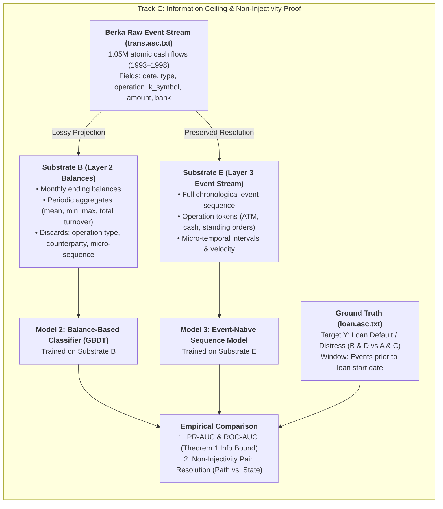

# Track C: Retail Banking Benchmark (Berka PKDD'99 Corpus)
## Paper 2: Business Event Repositories as Training Corpora for Enterprise AI

**Status:** Draft / Active Implementation.
**Corpus:** Berka Financial Dataset (PKDD'99 Discovery Challenge).
**Role in Monograph:** Complementary empirical benchmark for Paper 2 (Lossy Compression & AI Information Ceiling).

---

## 1. Executive Summary & Purpose

The central thesis of Paper 2 is that posting transactions into periodic balance aggregates (General Ledgers, subledgers, OLAP cubes) constitutes **lossy compression in the Shannon sense** (Theorem 1, §2.1):

$$I(\mathcal{E}^*; Y) \ge I(\mathcal{B}; Y)$$

While Track B evaluates this principle in government procurement (Virginia public POs vs. expenditures), **Track C** evaluates it in a **commercial retail banking environment** with ground-truth contract outcomes.

Using the Berka PKDD'99 banking dataset (4,500 accounts, 1,056,320 transactions, 682 granted loans with default status $A$–$D$), Track C directly compares:
1. **Layer 2 (Compressed Balances $\mathcal{B}$)**: Monthly statement balances, average rolling balances, and turnover aggregates.
2. **Layer 3 (Pre-Hierarchy Event Stream $\mathcal{E}^*$)**: Uncompressed, chronological transaction events (operation modes, purpose codes, counterparty bank identifiers, inter-arrival intervals $\Delta t$).

---

## 2. Dataset Entities & Ground Truth Target

### 2.1 The Target Phenomenon ($Y$)
* **Source**: `loan.asc.txt` (682 records, granted between 1993 and 1998).
* **Target Classification**:
  * $Y = 0$ (Good Credit): Status `A` (contract finished, no problems) and Status `C` (running contract, OK so far).
  * $Y = 1$ (Default / Credit Distress): Status `B` (contract finished, loan unpaid) and Status `D` (running contract, client in debt/delinquent).
  * Class Distribution: ~11.1% default/distress (76 defaults / 682 total).

### 2.2 Temporal Observation Window
* For each account $a$ receiving a loan on date $T_{\text{loan}}$, only transactions strictly occurring at $t < T_{\text{loan}}$ are used for feature/sequence extraction.
* This guarantees zero look-ahead bias.

---

## 3. Substrate Construction

### Substrate B: Compressed Balance Aggregates (Layer 2)
Simulates what a standard financial data warehouse / General Ledger preserves:
* Monthly closing balance series ($B_{T-1}, B_{T-2}, \dots, B_{T-12}$).
* 3-month, 6-month, and 12-month summary statistics:
  * Mean balance, min balance, max balance, standard deviation of balance.
  * Total credit volume, total debit volume, net cash flow.
* Demographic features: District demographics (`A4`–`A16`).

### Substrate E: Atomic Event Sequence (Layer 3)
Preserves the full multi-dimensional event tuple $e_i = \langle t_i, \Delta t_i, \text{type}_i, \text{op}_i, k\_sym_i, \text{amt}_i \rangle$:
* Exact transaction operation types (`VYBER KARTOU` = card withdrawal, `VKLAD` = cash deposit, `PREVOD Z UCTU` = collection from bank, `VYBER` = cash withdrawal, `PREVOD NA UCET` = remittance).
* Transaction purpose codes (`POJISTNE` = insurance, `SLUZBY` = statement, `UROK` = interest, `SANKC. UROK` = sanction interest, `SIPO` = household, `DUCHOD` = pension, `UVER` = loan payment).
* Micro-temporal dynamics: Inter-arrival intervals between deposits and cash drain events.

---

## 4. The Core Hypotheses & Tests

### Test 1: Information Ceiling Gap (Theorem 1)
* **Hypothesis**: The event-native model ($M_E$) achieves strictly higher PR-AUC and ROC-AUC than the balance-aggregated model ($M_B$), confirming $I(\mathcal{E}^*; Y) > I(\mathcal{B}; Y)$.

### Test 2: The Non-Injectivity Proof (Path vs. State)
* **Hypothesis**: Pairs of accounts with indistinguishable monthly balance profiles $(B_1 \approx B_2)$ can exhibit opposite default outcomes ($Y_1 \neq Y_2$).
* **Mechanism**: $M_B$ assigns near-identical risk $P(Y \mid B_1) \approx P(Y \mid B_2)$ due to non-injective compression, whereas $M_E$ distinguishes them by detecting event sequences (e.g. 100% immediate cash extraction upon salary deposit).

---

## 5. Artifacts and Outputs

* **Substrate Extractor**: `scripts/berka/build_berka_substrates.py`
* **Model Trainer & Evaluator**: `scripts/berka/fit_track_c_models.py`
* **Pipeline Runner**: `scripts/run_track_c_berka.sh`
* **Evidence Output**: `data/test_evidence/TRACK_C_BERKA_EVIDENCE.json`
* **Monograph Paper 2 Draft Text**: [`docs/PAPER_2_TRACK_C_INSERTION_DRAFT.md`](PAPER_2_TRACK_C_INSERTION_DRAFT.md)
