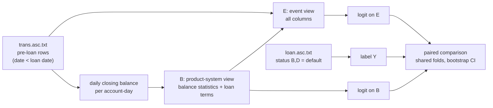

# Track C: Retail Banking Benchmark (Berka PKDD'99 Corpus)
## Paper 2: Business Event Repositories as Training Corpora for Enterprise AI

> **Decision 2026-11-10 (owner): Track C is illustrative only, not evidence for Paper 2.** First limitation: **lineage unknown.** Berka is a public extract and nothing documents how the files were produced from the originating bank's systems. We cannot tell whether the per-row balance came from the bank's system or was computed when the challenge file was built; whether the 1.3% balance breaks and the 355 unreconcilable days are system behaviour or extract artefacts; how loan status was assigned; or how accounts and counterparties were selected and masked. The result therefore shows what a model can learn from this table, not what a bank's posting system keeps or discards, which is what Theorem 1 is about. The design, code and numbers below are kept as a worked example of the audit method and as a reproducible exploratory result. Do not cite them as support for Theorem 1. Stronger evidence needs a source whose path from originating system to ledger is known.

**Status:** v2 protocol implemented and run once on 2026-11-10 (see §6). The v1 design (monthly "compressed" balances, GBDT / sequence model) is withdrawn; see the 2026-11-10 sections of [`VERIFICATION_AUDIT_REGISTER.md`](VERIFICATION_AUDIT_REGISTER.md) for why.
**Corpus:** Berka Financial Dataset (PKDD'99 Discovery Challenge), fetched by `scripts/download_berka.sh` (terms of use unconfirmed; data stays outside the repository).
**Role in Monograph:** None as evidence (see the decision above). At most a footnote-level illustration labelled "public extract of unknown lineage, exploratory". Not an engine measurement.

---

## 1. Question

Theorem 1 says reducing business events to balances can only lose information about outcomes. Track C asks it in a retail-bank setting with a ground-truth outcome:

> Does a model that sees a bank account's transactions predict loan default better than a model that sees only that account's daily balance, using the same loans, the same pre-loan window, the same folds and the same learner?

Nothing in the design depends on the balance column being "posted state". In the Berka file every transaction row carries the running balance after it. A product system holds an end-of-day balance per account, and that is the reduced view tested here.

## 2. Two views of one set of rows

Both views are built from the same pre-loan rows of `trans.asc.txt`. There is no second dataset.

| View | Built from | Keeps | Drops |
|---|---|---|---|
| **E** (event view) | the transaction rows as recorded | everything: `type`, `operation`, `k_symbol`, `amount`, partner `bank` / `account`, date, intra-day multiplicity | nothing |
| **B** (product-system view) | E rolled up to account-day | one closing balance per account per day, carried forward on days with no activity; the three loan terms | intra-day sequence; operation; purpose code; counterparty; amounts of individual transactions (only day-level net movement survives) |

**E is a strict superset of B by construction.** `build_berka_substrates.py` computes B's columns from the daily series and then adds event-derived columns to produce E; an assertion checks that every B column is in E. Both use the same history-length scaling (`*_per30` = per 30 days of observed history).

### 2.1 Daily closing balance
The file gives no usable intra-day order (`trans_id` does not follow it). The closing balance of an account-day is the balance of the row that ends the day, recovered from the balance chain: row *j* may follow row *i* if `balance[j] - balance[i] = signed_amount[j]` in integer cents (`PRIJEM` = credit, `VYDAJ` and `VYBER` = debits). Results over the 42,671 pre-loan account-days: 32,590 single-row; 9,725 with a unique recovered order; 355 with no consistent order and 1 with an ambiguous close (both use the last row in file order). The cause of the 355 is not examined; the source balance chain is known to break on `UROK` interest and `UVER` loan-payment rows (1.3% of unambiguous transitions), which are candidates.

### 2.2 Why a running balance on every row is not "posting"
Storing a balance per transaction adds nothing to processing or storage: it is a running sum of the signed amounts. It is a statement field. The reduction that Theorem 1 is about is the roll-up from transactions to a balance at a stated grain. Daily is the grain a product system keeps, and it preserves almost all of the overdraft signal (26 of 76 defaults flagged by a negative daily close, against 27 by any per-transaction balance and 14 by month-end closings), so B is not handicapped by a contrived grain. A GL view was considered and rejected: nobody would query a general ledger for a borrower's default risk.

## 3. Target and window
* `loan.asc.txt`: 682 loans, one per account. `Y = 1` for status B or D (76), `Y = 0` for A or C (606).
* Only transactions strictly before the loan date feed either view.
* District demographics are not used (the 1996 columns post-date loans granted 1993-95). `order.asc.txt` is not used (undated; every loan has its own repayment order, which would leak the outcome). Card issuance carried no signal (AUC 0.53) and is not used.

## 4. Features (all counts and amounts per 30 days of history unless a ratio)
* **B (15 columns):** `loan_amount`, `duration`, `payments`, `history_days`; daily-series `bal_mean`, `bal_min`, `bal_max`, `bal_std`, `bal_last`, `bal_last30_mean`, `days_negative`, `days_below_5000`; day-to-day movement `credit_per30`, `debit_per30`, `changed_days_per30`.
* **E adds 22 columns** that a daily balance cannot express: transaction rate and multi-transaction-day share; counts and amounts by `operation` (cash withdrawal, card withdrawal, cash deposit, transfers in and out); counts by `k_symbol` (`SIPO`, `SLUZBY`, `POJISTNE`, `DUCHOD`, `SANKC. UROK`); cash drain ratio; mean gap between transactions; distinct counterparty accounts and banks, counterparty transaction rate and share.

## 5. Protocol (fixed before the first run)
* **Learner:** L2 logistic regression solved by Newton iterations, unweighted classes, `sign(x)·log1p(|x|)` then standardisation inside each training fold. Primary penalty λ = 10. λ = 1 and λ = 100 are reported as sensitivity only. One learner for B and E; no tuning on results.
* **Folds:** stratified 5-fold repeated 20 times (seeds 0-19), identical for B and E.
* **Headline:** ROC-AUC of out-of-fold scores averaged over the 20 repeats, per loan. PR-AUC, Brier and log-loss are also stored, with the constant-prevalence Brier (0.0990) and log-loss (0.3495) as references.
* **Interval:** 2,000 stratified bootstrap resamples of loans, paired between B and E. This reflects loan-sampling uncertainty for the fixed procedure; it does not refit per resample.
* **Baselines:** loan terms only; the overdraft rule (any negative daily close before the loan).
* **Subsets:** all 682 loans, and the 656 with no pre-loan overdraft (50 defaults), because the overdraft rule already separates 26 defaults with no false positives.
* **Test 2 (non-injectivity, redefined):** for each default, find its five nearest non-defaults in balance-profile space (standardised sign-log `bal_mean`, `bal_min`, `bal_std`, `bal_last`, `bal_last30_mean`; no distance cutoff) and compare the default's score with the mean score of those neighbours, for B and for E. The unit is the default, not the pair.
* **Post-hoc arms** (added after the first run, labelled as such in the code and evidence): (a) E without counterparty columns, B plus counterparty columns only, and the same for `SANKC. UROK`; (b) **events only**: loan terms, `history_days` and the 22 event columns, with no balance-derived column, to test whether balances or events carry more on their own.

## 6. Result of the single v2 run (2026-11-10)

| | All 682 loans (76 defaults) | No pre-loan overdraft (656 loans, 50 defaults) |
|---|---|---|
| Loan terms only, ROC-AUC | 0.653 [0.587, 0.719] | 0.633 [0.547, 0.721] |
| **B** (daily balance), ROC-AUC | 0.864 [0.812, 0.911] | 0.790 [0.716, 0.860] |
| **E** (events), ROC-AUC | 0.898 [0.857, 0.937] | 0.837 [0.774, 0.893] |
| **E − B**, ROC-AUC (paired 95%) | **+0.034 [+0.005, +0.064]** | **+0.047 [+0.004, +0.087]** |
| E − B, PR-AUC (paired 95%) | +0.069 [+0.020, +0.122] | +0.085 [+0.002, +0.179] |
| Overdraft rule | flags 26 defaults, 0 non-defaults | not applicable |
| Test 2: score gap default vs 5 nearest non-defaults, E − B | +0.043 [+0.016, +0.070] | +0.067 [+0.034, +0.100] |
| Same, win rate B / E | 0.795 / 0.845 | 0.676 / 0.740 |

Penalty sensitivity (E − B, ROC-AUC): λ = 1: +0.037 / +0.061; λ = 100: +0.020 / +0.023 (all loans / overdraft-free). Brier and log-loss of both models are below the constant-prevalence reference (B 0.0590, E 0.0540 vs 0.0990).

Post-hoc ablation, all loans: B plus counterparty columns only 0.892 (+0.028 over B, CI [+0.007, +0.053]); E without counterparty columns 0.887 (+0.024, CI [−0.004, +0.051]); B plus `SANKC. UROK` only +0.001 (CI [−0.003, +0.004]). The counterparty columns carry most of the gain; penalty interest carries none once the overdraft is in B.

Post-hoc events-only arm (no balance-derived column):

| ROC-AUC | All 682 loans | No pre-loan overdraft |
|---|---|---|
| Events only | 0.864 | 0.805 |
| B (daily balance) | 0.864 | 0.790 |
| E (balance plus events) | 0.898 | 0.837 |
| B − events only (paired 95%) | −0.000 [−0.048, +0.048] | −0.015 [−0.089, +0.066] |
| E − events only (paired 95%) | +0.034 [+0.007, +0.063] | +0.032 [−0.011, +0.077] |

A daily balance and the event features are statistically tied as stand-alone views; the combination is ahead of the events-only view on all loans and inconclusive on the overdraft-free set.

## 7. What can and cannot be claimed
* The sign of E − B is consistently positive across both subsets, all three penalties and both tests, and the paired intervals exclude zero. The size is modest: about three to five AUC points on 76 (or 50) defaults.
* The intervals are conditional on the fixed procedure and on this one corpus; the bootstrap does not reflect model-selection variance and the 20 repeats are not independent samples. Do not read them as a population-level 95% claim.
* **Balance is not redundant, and events are not obsolete.** Events alone (aggregate features, no balance column) match the daily balance alone, and neither dominates the combination. The supported reading is that a ledger should keep the daily balance and retain the events, not choose one. It does not show that a balance-led store beats an event stream: the event view here is aggregates, not a sequence model, so "tied" applies to this feature design; the events-only arm includes `SANKC. UROK` counts, which partly proxy the overdraft.
* Most of the gain comes from counterparty diversity (fewer distinct partner accounts among defaults). This is an event attribute a daily balance cannot hold, which is what the experiment targets, but it may also proxy for account maturity, household type or a customer segment. History length and transaction rate are in both views; independence from other account traits is not shown.
* Berka is one 1990s Czech retail dataset, 76 defaults, and the label is partly a function of the balance path after the observation window. The result is evidence in one domain, not a general proof of Theorem 1.
* The post-hoc ablation and the events-only arm were chosen after seeing the first result and are exploratory.
* Intra-day order was recovered for 9,725 of the 10,081 multi-row days; 356 days use a fallback.

## 8a. Direct non-injectivity count (added 2026-11-10, no model; AIM1 analogue)
Script `scripts/berka/count_noninjectivity.py`, standard library only, evidence `data/test_evidence/TRACK_C_BERKA_NONINJECTIVITY.json`. It counts how the daily-balance grain we built collapses event rows. It does not use the recovered intra-day order. Event kind = (`type`, `operation`, `k_symbol`); event pattern = the sorted multiset of kinds over a day's rows. The closing level is not used as the key (it carries the whole history, so nearly every key is unique); the key is the day's net change, the part of B one day contributes.

Over 54,694 pre-loan rows and 42,671 active account-days:
* **Per account-day:** 10,081 days (23.6%) have more than one row; 9,144 (21.4%) hold more than one event kind under the one stored number; 7,938 net a credit and a debit together. Up to 5 event kinds sit under one day's number. Adding the counterparty account raises the count of days with 2 or more distinct events from 9,144 to 9,440.
* **Per net-change value (all active days):** 4,285 net-change values occur on two or more days; 1,942 (45.3%) are produced by more than one event pattern, and those values cover 19,414 of 34,509 account-days (56.3%). One value maps to as many as 6 patterns (for example -2,400 CZK on 198 days).
* **Single-row days only (no netting):** 177 of 2,494 repeated values (7.1%) still map to more than one pattern, covering 8,911 of 27,434 days (32.5%). Here the collision is by amount alone. The largest groups are mostly plain cash withdrawals with a few standing-order (`SIPO`) or card withdrawals at the same amount (for example 2,400 CZK: 192 cash, 2 card, 1 `SIPO`; checked against the rows).

**Reading.** A daily balance cannot recover which event produced a number, in about one account-day in five by netting (18.6% net a credit and a debit), and, among account-days whose amount repeats, in about a third even without netting. This is a property of our roll-up of these rows; it needs no model and does not depend on the default label. It does not say what a bank's posting system keeps, because the lineage of the files is unknown, and round amounts make some collisions likely by chance: the count shows what B cannot separate, not that the separated events matter for default. That second question is the predictive comparison in section 6.

## 9. v3 Protocol (designed and run 2026-11-10; overall FAIL against the locked thresholds)

v3 adds the four items the v2 run lacked. It is a separate script (`scripts/berka/fit_track_c_v3.py`) that reads the same substrate CSVs; v2 is unchanged and still runs as step 3 of the runner.

**Substrate change:** `build_berka_substrates.py` now writes `grant_date` (ISO, loan grant date) on every row, required for the temporal split. Re-run `build_berka_substrates.py` before running v3 on existing processed data.

### 9.1 Locked acceptance thresholds (declared before any v3 run)

| ID | Threshold | Metric |
|---|---|---|
| T1 | paired 95% CI lower bound on E−B ROC-AUC > 0.00 | repeated nested-CV, all loans |
| T2 | temporal-split test-set E ROC-AUC > B ROC-AUC (sign positive) | 60/40 train/test by grant_date |
| T3 | permutation p < 0.05 (one-sided) | 999 permutations of the 22 event-only columns |

These are illustrative thresholds on one corpus (76 defaults). Passing all three does not prove Theorem 1 but sharpens the v2 result. A fail on one or more is also informative and must be reported as-is.

### 9.2 Nested-CV lambda tuning

The outer loop is the same stratified 5-fold × 20 repeats as v2. Inside each outer training set, a 3-fold inner CV picks the best λ from `{0.1, 1, 10, 100}`. The chosen lambda per fold is reported in the evidence file. The v2 result fixed λ = 10; if the inner CV consistently picks a different value the headline AUC will differ.

### 9.3 Temporal split

Loans are sorted by `grant_date`; the first 60% (by date) are training, the last 40% are test. A separate inner CV on the training set picks λ. No repeated resampling: the split is single-shot. This checks whether the event gain generalises forward in time, not just across folds of the same time window. The Berka corpus covers loans from 1993 to 1998, so the split is within a six-year window.

### 9.4 Permutation test on the 22 event-only columns

Independently permute (shuffle) each of the 22 event-only columns (`cols_e_extra`) across loans, rerun the full nested-CV, and record E−B. Repeat 999 times. The one-sided p-value is the fraction of permuted gains ≥ the real gain. This is the standard column-permutation test: it asks whether the event-column signal could arise by chance at the observed feature structure.

**Runtime note:** the permutation test runs 999 complete nested-CV evaluations of both B and the permuted E. With 682 loans, 5×20 outer folds, 3 inner folds and 4 lambda values, each evaluation fits approximately 120 × 4 = 480 logistic regressions. 999 × 2 × 480 ≈ 958,000 model fits. On a laptop this is expected to take 30–90 minutes depending on hardware.

### 9.4a Result of the single v3 run (2026-11-10)

Run via `scripts/run_track_c_berka.sh` with `BERKA_DATA_ROOT=/tmp/berka_root_test` (files verified by SHA-256; substrates rebuilt with `grant_date`). Evidence: `data/test_evidence/TRACK_C_BERKA_V3_EVIDENCE.json`. Thresholds in §9.1 were not changed.

| ID | Threshold | Observed | Verdict |
|---|---|---|---|
| T1 | paired 95% CI lower bound on E−B ROC-AUC > 0.00 | all loans: B 0.8665, E 0.9098, gain +0.0433, CI [0.0126, 0.0760] | **PASS** |
| T2 | temporal-split test E ROC-AUC > B | train 409 loans (55 defaults), test 273 loans (21 defaults), cutoff 1997-06-13; B 0.9240, E 0.9227, E−B −0.0013 | **FAIL** |
| T3 | permutation p < 0.05 | real gain +0.0433; permuted gains mean −0.0264, sd 0.0127; 0 of 999 permuted gains ≥ real | **PASS** |

Overall: **FAIL** (T1 and T3 pass, T2 fails). Reported as-is.

Supporting numbers:

* Overdraft-free loans (656 loans, 50 defaults), T1 analogue: B 0.7889, E 0.8575, gain +0.0685, CI [0.0213, 0.1233].
* Chosen λ (outer folds, all loans) — B: 0.1 ×7, 1 ×60, 10 ×32, 100 ×1; E: 0.1 ×37, 1 ×39, 10 ×24, 100 ×0. λ = 10, fixed in v2, was not the modal choice.
* Brier (all loans): B 0.0590, E 0.0510.
* Nearest-neighbour test (balance-profile space): E−B gap gain +0.1000 [0.0622, 0.1405] (all loans); +0.1285 [0.0802, 0.1802] (overdraft-free).

**Reading.** The event columns add a gain under repeated nested-CV that is unlikely to arise from column structure alone: permuted event columns lower the AUC on average (−0.026), and none of the 999 permutations reached the real gain. The gain did **not** carry into the single forward-in-time split, where B and E tie to the third decimal (−0.0013). The test set holds 21 defaults, so a ROC-AUC difference of this size is far inside sampling noise; the T2 FAIL is a failure to show a positive sign, not evidence that E is worse than B. The permutation p is bounded below by 1/1000 with 999 permutations; the script prints 0.0000 (no +1 correction). The result stays illustrative: one corpus, 76 defaults, unknown file lineage.

### 9.5 Not included in v3 (deferred or out of scope)

* Counterparty-diversity vs account-age independence check (owner decision required before implementing).
* The 355 account-days with no consistent balance chain: `UROK`/`UVER` candidates, not examined.
* Terms-of-use confirmation for the Berka data set (still open).

## 8. Artifacts
* **Download (Bash):** `scripts/download_berka.sh`
* **Substrate builder:** `scripts/berka/build_berka_substrates.py` → `substrate_b_daily_balance.csv`, `substrate_e_events.csv`, `daily_balance_series.csv`, `build_stats.json` in `data/berka_processed/` (git-ignored). v3 adds `grant_date` column to both substrate CSVs.
* **v2 fit and evaluation:** `scripts/berka/fit_track_c_models.py` → `data/test_evidence/TRACK_C_BERKA_EVIDENCE.json`
* **Non-injectivity count (§8a):** `scripts/berka/count_noninjectivity.py` → `data/test_evidence/TRACK_C_BERKA_NONINJECTIVITY.json`
* **v3 fit (§9):** `scripts/berka/fit_track_c_v3.py` → `data/test_evidence/TRACK_C_BERKA_V3_EVIDENCE.json` (run 2026-11-10; see §9.4a)
* **Runner:** `scripts/run_track_c_berka.sh` (needs `BERKA_DATA_ROOT`; v3 is step 5)
* **Python status:** Track C Python is owner-approved (2026-11-10), scope Track C only; it is not an engine or cost-curve measurement.
