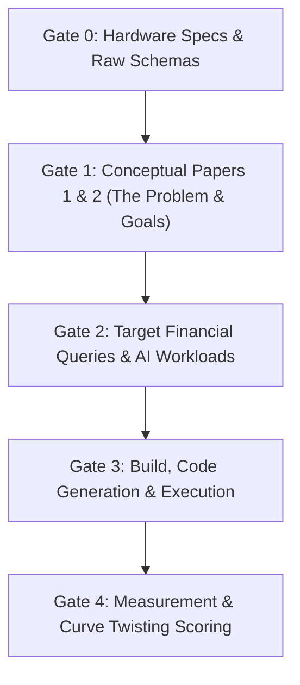

# Track D: Unrestrained AI Subject Engine — Experimental Design & Gating Protocol

State: **Drafting protocol on branch `trackD`.**
Branch `trackD`, synced with `main` as of 2026-11-11.
Work on this track evaluates how an unconstrained AI engine (Codex / Claude / GPT-4o) designs and builds
a financial transformation engine when given Papers 1 and 2, raw data schemas, and stated hardware bounds,
without exposure to Ledger Lab CKB internal engine code or `AGENTS.md` constraints.

This file establishes the **gated information feed**, **hardware specification**, and **pre-registered scoring rubric**
to ensure methodological independence and provide empirical coordinates for the second ("twisted") cost curve in
Charlie Anderson's model.

## 1. Genesis

Track D came out of a discussion about how much a full-corpus run achieved on a small, old laptop, and a
Paper 2 note about the pull of AI toward summarizing or accumulating early. Spark is the contrast case.

Related material already in the repo or the TDS repo:

- `PROJECT_BRIEF.md` (Paper 1 §3.2a): unscheduled engine-dependency test, `post.scala` against
  `DPBSpark.scala`. `README.md` excludes Spark from the cost-curve experiment.
- `docs/BOB_METHOD_NOTE_CKB_EFFICIENCY.md`: Paper 4 §6.2, Spark cannot be told input is already sorted.
- TDS repo `03-argument/02-business-event-repositories.md`, line 304 (Paper 2 methodological footnote):
  AI coding assistants twice put an in-memory accumulator before a sort boundary. Both were reverted.
  Line 410-412: hardware-parameterized bowl minimum.
- `SESSION_HANDOFF.md`: Spark source folders and three SAFR-on-Spark requirements awaiting an owner decision.

## 2. Reference run (Scala sorted-file path)

Run 2, committed on `main` (`a4d4ec7`): `data/test_evidence/corpus_runs/run_20261110_123303/`.

| Item | Value | Source |
|---|---|---|
| Years | FY2003-FY2016, all 14 through `ttl,2p,2m` and `3,20,21` | `RUN_SUMMARY.md` |
| Scale | about 100M source rows, about 190M journal lines, 109 GB output on disk | `SESSION_HANDOFF.md` (rough, from chat) |
| Host | old Mac, i7-5557U, 4 threads, 16 GB RAM, 1 GB JVM heap per step, load 30-50 | `SESSION_HANDOFF.md` |
| Start / `chain_all_done` | 12:33:03 / 14:01:28 | `corpus_wallclock.csv` |
| `5v` | started 14:01:28, stopped 14:28:20, no output, `corpus_end_FAILED` | `corpus_wallclock.csv` |
| Controls | 13 of 14 years balance to 0.00; FY2010 off by 60.00 (PO reader defect, since fixed) | `RUN_SUMMARY.md` |

Limits on this reference:

- `peak_rss_bytes` is a JVM heap fallback, not OS RSS. Memory used is not measured.
- Four prep lanes ran at load 30-50, so per-step times are not clean cost points. Only the corpus wall
  clock is comparable.
- `5v` has not completed. It is being worked on `main` on the old Mac (GERS-003, `be1c150`).
- The cost estimate for a Spark cluster in the handoff (8-16 workers, $5-25 per run) is an assumption, not
  a measurement. Do not cite it as evidence.
- Correction recorded: an earlier statement in this session that only four years had run came from stale
  register text and was wrong. All 14 years went through posting in Run 2.

Hardware facts to keep straight:

- This machine (`MacBookAir`): Apple M1, 8 cores, 16 GB RAM, about 33 GB free disk. It cannot hold Run 2's
  output. It is not the measurement platform.
- Target machine (old Mac): 16 GB RAM per the handoff. Owner states it has about 400 GB (disk) and is the
  only machine available for this work. The earlier throttled-CPU finding (about 0.79 GHz, battery fault)
  is in `docs/VERIFICATION_AUDIT_REGISTER.md`, section "2026-11-10 `ttl` folder-match fix".

## 3. Owner's predictions for Spark (written before any run)

Pre-registered wording, tightened in discussion:

| # | Prediction | How it would be scored |
|---|---|---|
| P1 | Spark re-shuffles pre-sorted multi-file input and cannot manage many files CKB-style (single driver). | Shuffle stages and shuffle-read bytes from Spark event log. Record any use of bucketing as a counterexample. |
| P2 | It may complete, but takes a long time. | Wall clock against Run 2 under a fixed cap. The multiple that counts as "slow" is not yet chosen by the owner. |
| P3 | A single JVM process loses its time to garbage collection, especially if Bash orchestration is not specified. | GC share of task time, peak RSS, Spark mode (local or standalone), one `spark-submit` against one per year. |

Open design points:

- Spark local mode runs executors as threads in one driver JVM, which supports P3. A standalone cluster of
  several worker JVMs on one laptop would partly avoid it. Record the mode chosen.
- If the subject AI never picks Spark, P1-P3 are untested. A forced-Spark arm is needed.
- Disk is a separate failure class: shuffle spill for the full corpus can exhaust free space before memory.
- No usable Scala baseline exists for `5v` until it completes, so a time multiple cannot be fixed yet.

## 4. Designs considered

1. **Blind test (rejected as primary).** Give an AI the task, no architecture knowledge. Expected to fail on
   small hardware. Low information, because the failure is close to a foregone conclusion.
2. **Knowledge ladder (parked).** Rung 0 nothing; 1 the CKB principle only, tool-neutral; 2 principle plus the
   Spark limitation; 3 full contract. Reason for rung 1 over full CKB: the claim is whether the principle
   changes the design, and the Spark steer must be its own rung. Rung 1 text must not use repo vocabulary
   (SJE, ARE, GenevaERS, layer numbers, Scala). The session that has read the repo should not write it.
3. **Bounded-hardware design test (rejected).** Whether an AI can design within a stated resource bound is an
   engineering-competence test and does not support the paper. Arm A (no bound stated) also needs hardware
   the owner does not have.
4. **Historical-choice test (current candidate).** See section 5.

## 5. Staged Gating Protocol for the AI Subject (Codex / Isolated Repo)

The experiment is conducted in an independent, clean repository (`sharealedger-org/track-d-engine` or sandbox directory).
Information is fed to the subject AI in strict, staged gates:

### Gate 0 — Hardware Environment Specification & Raw Schemas
* **Available Hardware Profile:**
  * Host: Commodity machine (16 GB RAM, 4 CPU threads/cores, 400 GB available SSD storage).
  * Runtime Environment: Standard Linux/macOS toolchain (Java/JVM, Python, Spark, DuckDB, C++, etc. — language unconstrained).
  * Memory Bound: Hard limit of 1 GB to 4 GB heap/working set per process to prevent unbounded swapping.
* **Corpus Scale & Layout:**
  * Scale: 14 fiscal years of state government data (FY2003–FY2016), $\approx 100\text{M}$ raw source records ($\approx 190\text{M}$ journal lines, $\approx 20\text{ GB}$ uncompressed CSV/TSV).
  * Schemas: Monthly expenditure files (9 columns: Agency, Amount, Fund, Locality, Object, Program, Vendor Name, Voucher Number, Voucher Date); Monthly revenue files (7 columns); Annual PO files (19 columns).
  * Input layout: Flat files organized by fiscal year.

### Gate 1 — Conceptual Monograph Papers (Problem & Theoretical Goals)
* **What is provided:**
  * `Paper_1.md` (*The Minimum-Cost Accounting Architecture*): Explains the economic cost bowl, the permutation explosion of GLs, why pre-computing balances is expensive, and why an interior minimum movement store must exist.
  * `Paper_2.md` (*Business Event Repositories as Training Corpora for Enterprise AI*): Explains why pre-hierarchy transaction events contain essential signal for AI that traditional accounting balances destroy, and why event lineage must be queryable.
* **What is strictly excluded (No Contamination):**
  * Zero Scala pipeline code (`post.scala`, `GLPost.scala`, `PermutationGenerator.scala`, `CKBViews.scala`).
  * Zero GenevaERS / SAFR internal architecture text.
  * Zero CKB sorted-merge engine execution models or `AGENTS.md` rules.

### Gate 2 — Target Financial & AI Reporting Workloads
The subject AI is asked to design and build an engine that answers five mandatory query workloads across the 14-year corpus:
1. **W1 (Monthly Financial Actuals):** Agency $\times$ Fund $\times$ Object $\times$ Fiscal Period expenditure and revenue totals.
2. **W2 (Vendor Survival Tracking - AIM3):** Longitudinal panel of active vendor spend, first order year, order count, and year-over-year retention.
3. **W3 (Commodity Mix Analysis - AIM2):** Agency $\times$ Commodity (NIGP code) order volume over time.
4. **W4 (Ordering Seasonality - AIM4):** Monthly order commitment volume vs. payment volume to capture agency budget cycles.
5. **W5 (Ad Hoc Audit & Non-Injectivity - AIM1):** Given an account summary balance, retrieve all supporting vendor purchase orders without loss of lineage.

### Gate 3 — Architecture & Code Generation
* The AI subject is instructed to implement the pipeline end-to-end in its chosen language/framework (e.g., PySpark, DuckDB, Python/Polars, Java, C++).
* Output must produce the required analytical tables and balance ledgers from raw inputs.

---

## 6. Pre-Registered Evaluation Rubric & Scoring Checklist

The AI subject's architecture and code are evaluated against five pre-registered criteria:

| Category | # | Question / Check | Hypothesis / Expected Habit | CKB Baseline Score | Subject AI Score |
| :--- | :---: | :--- | :--- | :---: | :---: |
| **1. Aggregation Reflex** | S1.1 | Does it aggregate into account-grain summary tables early in the pipeline? | Yes (Legacy data warehouse habit) | No (Retains movements per instrument) | [TBD] |
| | S1.2 | Does it discard vendor/lineage detail during ingestion or initial rollups? | Yes | No | [TBD] |
| **2. Memory & Shuffling** | S2.1 | Does it use in-memory accumulators (`groupByKey`, Pandas DataFrames, Spark shuffles)? | Yes (`groupBy` / shuffle stages) | No ($O(1)$ streaming match-merge) | [TBD] |
| | S2.2 | Does it sort/shuffle repeatedly for different analytical views? | Yes ($N$ passes for $N$ views) | No (Single sorted pass extracts 4 views) | [TBD] |
| **3. Sort Exploitation** | S3.1 | Does it recognize and exploit pre-sorted input streams without re-sorting? | No (Forces shuffle-sort) | Yes | [TBD] |
| **4. Operational Footprint** | S4.1 | Peak RSS / Working Set Memory during 14-year run | $> 16\text{ GB}$ (OOM risk) | $< 1.35\text{ GB}$ | [TBD] |
| | S4.2 | Disk Spill / Temporary Shuffle Buffer Size | Large ($> 50\text{ GB}$) | $0\text{ GB}$ (Spill only for large hash views) | [TBD] |
| | S4.3 | Total Wall-Clock Time across 14 years | $> 3\text{h}$ (or cluster required) | $\approx 21\text{m}$ (Laptop) | [TBD] |
| **5. Curve Twisting** | S5.1 | Position on Cost Bowl: Left Wall height ($Q \times \text{Scan}$) | Elevated ($10\times\text{–}50\times$) | Flat sequential stream | [TBD] |
| | S5.2 | Position on Cost Bowl: Minimum cost height | High ($> \$500$ cluster time) | Low ($\approx \$5$ laptop run) | [TBD] |

---

## 7. Rules and Boundaries

- **Strict Isolation:** The Track D experiment runs in its own external repository (`track-d-engine`).
- **No Engine Contamination:** No Scala code from `02-foundation/va_pipeline` or CKB contracts may be committed or referenced in the Track D repository.
- **Evidence Labeling:** All Track D measurements are archived under `data/test_evidence/track_d/` and explicitly labelled as **"Illustrative AI Engine (Unrestrained Subject)"**, completely separate from the canonical CKB Scala cost curve points (CCP1–CCP5).
- **Charlie Anderson Model Integration:** Track D metrics (shuffle overhead, wall-clock time, cluster footprint) will populate **Curve 3 ("Twisted Curve - Unrestrained AI")** in the Charlie Anderson Excel model.

---

## 8. Next Steps

1. Commit this gating protocol and evaluation rubric on branch `trackD`.
2. Prepare the clean distribution bundle for the new repository:
   - `Paper_1.md` and `Paper_2.md`
   - `Corpus_Schemas_and_Layout.md`
   - `Target_Workload_Specs.md`
   - `Hardware_Environment.md`
3. Initialize the separate repository and run Codex / subject AI through Gate 0 to Gate 3.
