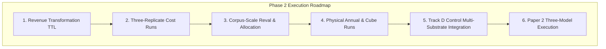

# Limits & Phase 2 Execution Roadmap (Paper 1, Rev 2)

**Scope:** Experimental Limits, Methodological Caveats, and Phase 2 Execution Priorities  
**Target:** TDS Open Tier / Review Committee  

---

## 1. Experimental Limits & Methodological Caveats

Every empirical claim in Paper 1 (Revision 2) must be evaluated within the context of the following defined boundaries:

1. **No Revenue Accounts in Gold Baseline:**
   * The current Gold dataset contains only expenditure lines (`EXP*`), purchase order commitments (`COMMIT`), and offset accounts (`0000`).
   * *Corpus Reality:* Raw public files contain 17,750,109 revenue events (`apa_revenue`). The exclusion is a stage boundary of the current Gold dataset, not a source limitation.
2. **Absence of Corpus-Scale Multi-Run Replicates per Cost Point:**
   * While three full 14-year corpus runs exist at the Monthly point ($X=30$ / P3 / CCP2), isolated three-replicate timing runs across all individual points (CCP1 through CCP5) under a fixed topology have not been completed.
   * Consequently, exact dollar comparisons between CCP layers remain model approximations.
3. **Unmeasured Mix Graph Points:**
   * **Annual ($X=15$ / P2):** Sized based on the 1/3 row reduction observed in early prototyping, not measured across a 14-year corpus run.
   * **Cubes ($X=60$ / P4):** Modeled as two parallel balance stores; no physical OLAP cube database was instantiated for the 14-year corpus.
4. **Hardware Specifics:**
   * The companion baseline was executed on a single 4-CPU, 16 GB RAM host with a 1 GB JVM maximum heap allocation.
5. **Orchestration & Control Overhead:**
   * Approximately 54% of chain wall clock time in parallel runs occurred after the Scala engine logged "Pipeline complete". This tail represents single-threaded `awk` control-total calculations executed in Bash.
6. **Purchase Order Data Discontinuities:**
   * Source PO files for FY2001–FY2005 are stubs/partial, FY2009 is absent in public disclosures, and FY2018 is partial. PO-dependent analyses are strictly bounded to FY2006–FY2008 and FY2010–FY2017.

---

## 2. Phase 2 Execution Roadmap

Following the submission of Paper 1 (Revision 2), Phase 2 will execute the remaining physical measurements to expand the empirical foundation:

### Planned Milestones

| Milestone | Action Item | Target Deliverable |
|---|---|---|
| **1. Revenue Pipeline** | Execute APA Revenue (17.75M rows) through the Scala TTL and ARE. | Balanced Gold dataset incorporating `REV*` accounts and enabling true fund-level net operating calculations. |
| **2. Isolated 3-Replicate Runs** | Run three isolated replicates of each cost point (CCP1 to CCP5) under a single quiet-host reference layout. | Empirically published compute seconds and storage curves with confidence intervals. |
| **3. Advanced Layer Corpus Runs** | Execute Revaluation (CCP4) and Prior-Day Divisor Allocation (CCP5) at full 14-year corpus scale. | Physical validation of the single-pass universality theorem (CCP5 $\approx$ CCP4 compute). |
| **4. Physical Graph Points** | Execute physical 14-year runs for Annual movements (`T-annual` / P2) and pre-computed rollup cubes (P4). | Replacement of model assumptions on the left and right slopes with measured run statistics. |
| **5. Multi-Substrate Integration** | Ingest and reconcile the completed Track D unconstrained control repository baseline. | Multi-substrate comparative cost curves (CKB vs. Conventional AI Engine) on Sheet 4. |
| **6. Paper 2 Model Training** | Resolve Net Income ground truth (D9), train Posted-FineTune vs. IL-FineTune vs. IL-Native models. | Completion of Paper 2 empirical proofs on information loss in posted accounting stores. |
