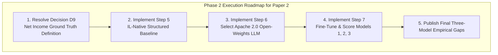

# Limits & Phase 2 Execution Roadmap (Paper 2, Rev 1)

**Scope:** Experimental Limits, Methodological Caveats, and Phase 2 Execution Roadmap for Paper 2  
**Target:** TDS Open Tier / Academic Review Committee  

---

## 1. Experimental Limits & Methodological Caveats

Every empirical claim in Paper 2 (Revision 1) must be evaluated within the context of the following boundaries:

1. **Current Benchmark Basis (Audited Expenditures):**
   * The active Three-Model experiment and AIM validation tests operate on the **audited expenditure basis** (`EXP*` debits). While raw public files contain 17.75M revenue records (`apa_revenue`), revenue has not yet been processed through the Scala TTL into Gold.
   * *Impact:* Models currently evaluate expenditure forecasting, commitment tracking, and vendor churn rather than net fund operating results.
2. **Model Training Stage (Steps 1–4 Complete; Steps 5–7 on Hold):**
   * The verbalizer, fixed-seed entity split generator, evaluation scoring harness, and Gold tie-out have been implemented and verified with 40 passing unit tests.
   * Actual LLM fine-tuning and scoring runs have not yet been executed (`not run`).
3. **Purchase Order Data Discontinuities:**
   * Public purchase order files for FY2001–FY2005 are stubs/partial, FY2009 is absent in Virginia state public archives, and FY2018 is partial.
   * *Mitigation:* All longitudinal PO-dependent experiments are strictly bounded to the continuous windows FY2006–FY2008 and FY2010–FY2017.

---

## 2. Phase 2 Execution Roadmap (Steps 5 through 7)

### Planned Milestones

| Milestone | Action Item | Target Deliverable |
|---|---|---|
| **1. Decision D9 Resolution** | Select the formal net operating target: net agency expenditure vs. fund reserves vs. ACFR GAAP statement tie-out. | Locked ground-truth specification for multi-fund financial statements. |
| **2. Step 5: IL-Native Implementation** | Implement the structured tabular baseline (LightGBM / XGBoost + TabNet) on native `LDGR` records without natural language serialization. | Pure language-free baseline for Model 3. |
| **3. Step 6: Model Selection** | Select an Apache 2.0 / MIT small open-weights LLM ($\le 3\text{B}$ parameters, e.g., Llama-3.2-3B or Qwen-2.5-3B) with verified security advisories. | Base foundation model for Models 1 and 2. |
| **4. Step 7: Fine-Tuning & Scoring** | Execute fine-tuning for Model 1 (Posted-FineTune) and Model 2 (IL-FineTune) on identical training splits (FY2010–FY2013), and score against Model 3 on hold-out test set (FY2014–FY2015). | Empirical measurement of Substrate Gap ($\Delta_{1 \to 2}$) and Language Prior Gap ($\Delta_{2 \to 3}$). |
| **5. Full AIM Suite Re-Run** | Re-run AIM1, AIM3, and AIM4 (using locked STL decomposition) on the final Gold views. | Final empirical evidence tables for Paper 2 publication. |
